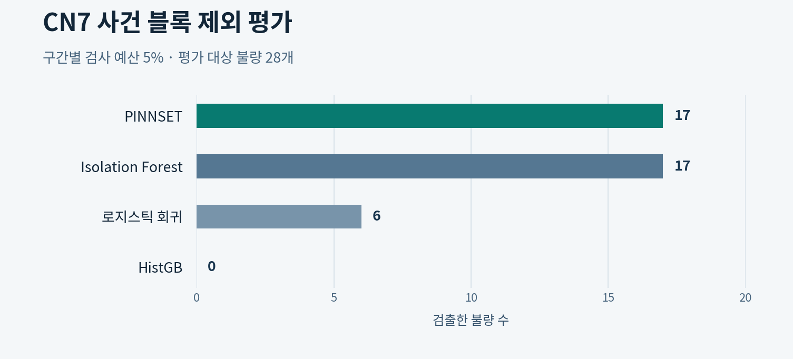

# PINNSET

**사출성형 공정 기록으로 검사 우선순위를 정하고, 불량 원인을 확인하려면 무엇을 더 측정할지 제안합니다.**

제6회 K-인공지능 제조데이터 분석 경진대회 일반국민·대학(원)생 부문 출품작입니다. 팀 PINNSET은 서면평가를 통과해 **발표평가 대상 8개 팀 중 하나**로 선정됐습니다.

## 문제

사출성형 한 샷에서 좌우 부품이 함께 생산되고, 두 부품은 대부분의 공정값을 공유합니다. CN7은 라벨이 있는 부품 3,974개 중 불량이 28개였고, 그중 27개가 두 사건에 집중돼 있었습니다. 이 데이터로 샷 종료 직후, 최종 품질검사 전에 어떤 부품부터 확인할지 정하는 문제를 풀었습니다.

## 접근법

| 구성 | 하는 일 |
| --- | --- |
| 검사 우선순위 | CN7은 사출속도·충진시간·사출시간·고화층 비율(FLR)이 정상 기준에서 얼마나 벗어났는지 계산하고 확률을 보정합니다. RG3는 캐비티 위치에 따른 위험 차이를 반영합니다. 기준이 부족하거나 학습한 레시피 범위를 벗어나면 판정을 보류합니다. |
| 물리 분석 | 예측에 들어가는 FLR은 냉각 해석식으로 계산합니다. 별도로 학습한 PINN은 금형 내 온도장과 고화층 변화를 추정해 공정 조건과 대응 후보를 비교하는 데 사용합니다. |
| 추가 측정 제안 | 관측을 추가했을 때 원인 가설을 얼마나 더 잘 구분할 수 있는지 야코비안으로 분석합니다. 대회 데이터에서는 캐비티별 부품 무게를 우선 측정 항목으로 제안했습니다. |

## 검증 결과



**모델 비교.** CN7 사건 블록 제외 평가에서 같은 검사 예산을 썼을 때 PINNSET과 Isolation Forest가 각각 불량 **17/28개**를 검출했습니다. 확률 예측의 Brier 점수는 학습 구간 불량률을 그대로 쓰는 기준보다 **35% 낮았습니다**.

**운영 규칙 평가.** CN7 시간순 평가에서 처음 기준을 만들 수 없는 구간을 제외하고, 판정 보류 부품의 대체검사까지 포함해 전체의 **4.6%**를 검사 대상으로 골랐습니다. 그 안에 불량 **10/11개**가 포함됐습니다.

시간순 평가와 사건 블록 제외 평가는 대회 제공 데이터에서 수행한 후향 평가입니다. 독립 불량 사건이 적고, RG3는 캐비티별 상태를 구분할 공정 센서가 부족했습니다. 추가 측정의 효과도 가정한 물리 모델과 측정 오차를 바탕으로 계산했습니다. [상세 검증 결과와 해석](docs/results.md)에서 비교 조건과 제품별 결과를 확인할 수 있습니다.

## 코드 둘러보기

| 파일 | 역할 |
| --- | --- |
| [pinnset_risk_v1.py](PINNSET_code/pinnset_risk_v1.py) | 샷 단위 순차 판정과 불량 확률 |
| [pinnset_strict.py](PINNSET_code/pinnset_strict.py) | 시간순·사건 블록 제외 평가와 모델 비교 |
| [pinn_torch/](PINNSET_code/pinn_torch/) | 온도장과 고화층 추정을 위한 PINN 학습 실험 |
| [pinnset_action.py](PINNSET_code/pinnset_action.py) · [pinnset_request.py](PINNSET_code/pinnset_request.py) | 공정 대응 후보 비교와 추가 측정 제안 |

## 재현

Python 3.12 환경을 준비하고, [KAMP 공지](https://www.kamp-ai.kr/noticeList)에서 안내하는 대회용 사출성형기 AI 데이터셋의 `labeled_data.csv`, `unlabeled_data.csv`를 `data/`에 넣습니다. Windows PowerShell에서는 먼저 `$env:PYTHONUTF8="1"`을 실행합니다.

```bash
cd PINNSET_code
python -m pip install -r requirements.txt
python run_all.py --data ../data --out results_reproduced
```

`results_reproduced/strict/`에서 검증 집계표를 확인할 수 있습니다. 기본 실행은 저장된 PINN 가중치를 사용합니다. 대시보드 생성, 새 레시피·수지 실험, PINN 재학습 방법은 [전체 재현 안내](PINNSET_code/README.md)에 있습니다.

이 저장소는 대회 분석·재현 코드와 제출 결과의 집계를 담고 있습니다. 원본 생산 CSV와 부품별 예측은 제외했습니다.
